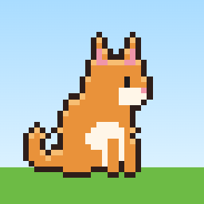
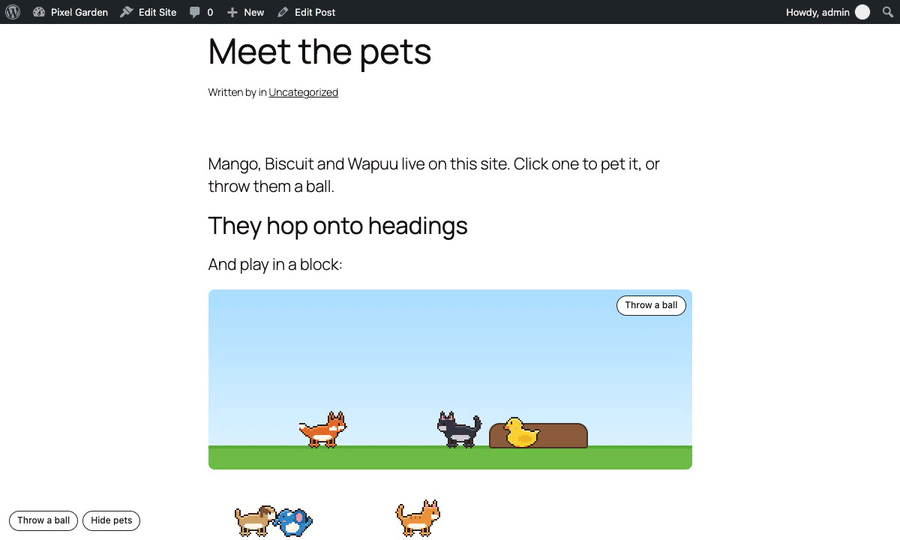
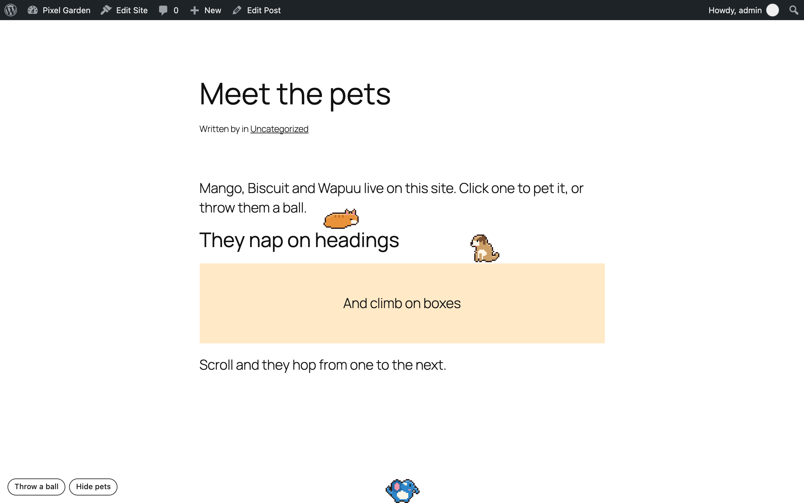
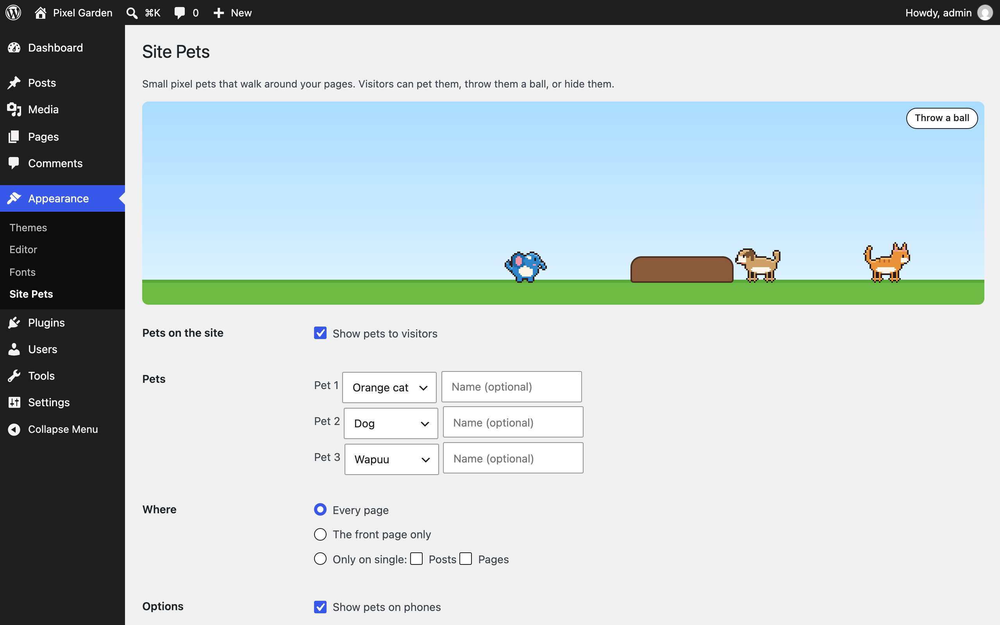
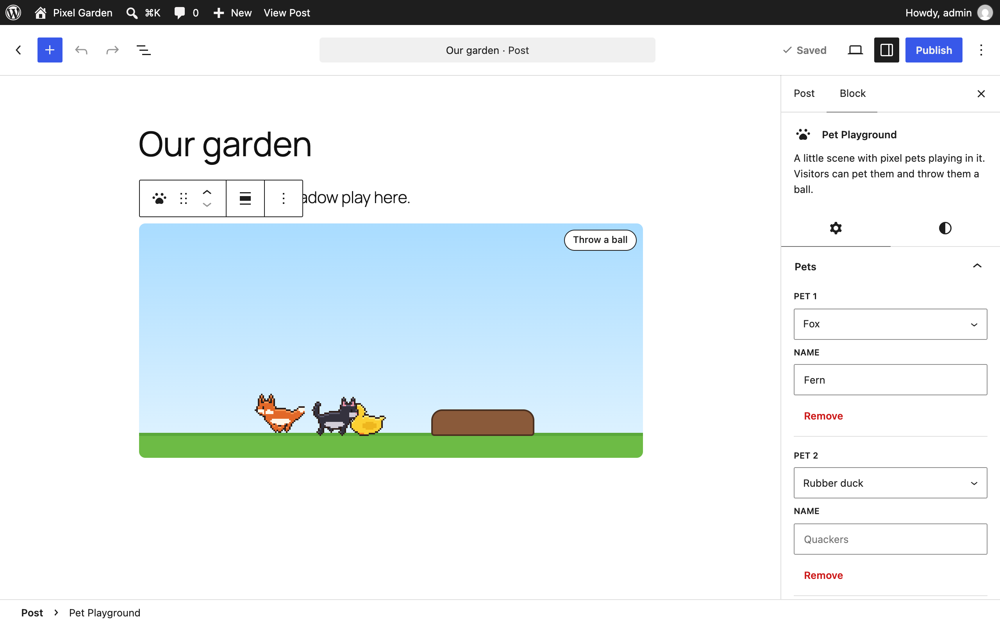
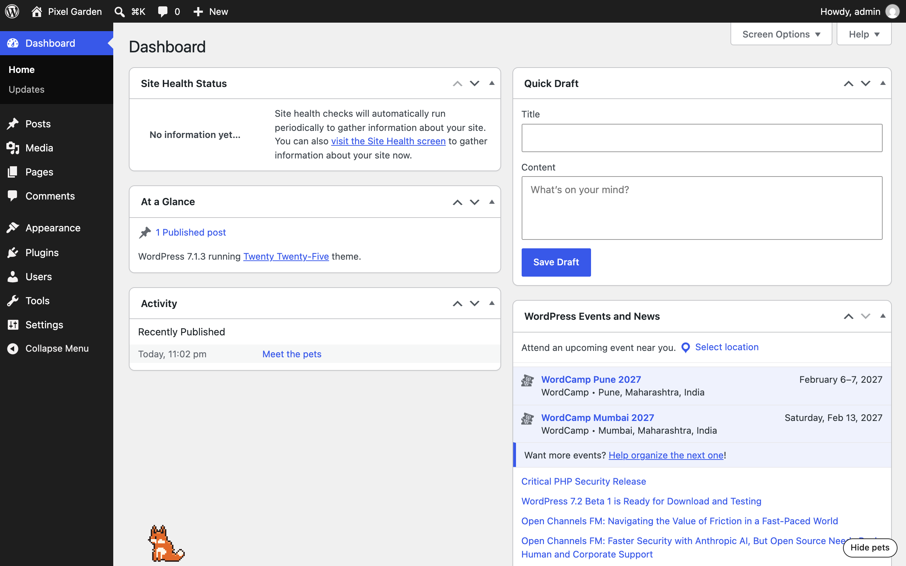

<p align="center"></p>

<h1 align="center">Site Pets</h1>

<p align="center">
  <a href="https://playground.wordpress.net/?blueprint-url=https://raw.githubusercontent.com/pratik-londhe4/site-pets/main/blueprint.json"></a>
  <a href="https://github.com/pratik-londhe4/site-pets/releases/latest"></a>
  
  
  <a href="LICENSE.md"></a>
  <br>
  <a href="https://github.com/pratik-londhe4/site-pets/actions/workflows/phpcs.yml"></a>
  <a href="https://github.com/pratik-londhe4/site-pets/actions/workflows/phpstan.yml"></a>
  <a href="https://github.com/pratik-londhe4/site-pets/actions/workflows/unit-tests.yml"></a>
  <a href="https://github.com/pratik-londhe4/site-pets/actions/workflows/e2e-tests.yml"></a>
  <a href="https://github.com/pratik-londhe4/site-pets/actions/workflows/plugin-check.yml"></a>
</p>

<p align="center">Little pixel pets that walk around your pages, a desk buddy in wp-admin, and a Pet Playground block.</p>

<p align="center">
  
</p>

---

Like [vscode-pets](https://github.com/tonybaloney/vscode-pets), for your WordPress site. A cat, dog, fox, rubber duck or Wapuu walks around your pages, naps, jumps onto your headings and fetches a ball when a visitor throws one.

> [!NOTE]
> Free and open source under the GPL. No pro version, no upsells, no ads in wp-admin, no tracking. The art is original and generated by a script in this repo.

## Features

- **Seven pets**: orange, grey and black cats, a dog, a fox, a rubber duck and Wapuu, up to three at once, each with a name
- **They walk on your layout**: headings, images, covers, quotes and buttons are platforms; scroll them away and the pets fall
- **Pet them, throw a ball, or hide them**: hiding is remembered in the visitor's browser
- **Desk buddy**: each user picks a pet on their profile that keeps them company in wp-admin
- **Pet Playground block**: a garden, beach or night scene with pets playing in it, live in the editor too
- **Kind to the page**: no layout shift, clicks go through to the page, about 8 KB of compressed JavaScript, stops in background tabs, still for people who prefer reduced motion
- **For developers**: add your own pets, PHP and `wp.hooks` filters, WP-CLI, Abilities API

## Install

1. Download `site-pets.zip` from the [latest release](https://github.com/pratik-londhe4/site-pets/releases/latest).
2. In WordPress, go to **Plugins > Add New Plugin > Upload Plugin**, choose the zip and activate it.

Or with WP-CLI:

```sh
wp plugin install https://github.com/pratik-londhe4/site-pets/releases/latest/download/site-pets.zip --activate
```

Needs WordPress 6.6+ and PHP 7.4+. An orange cat named Mango appears as soon as it is active. The **Try in WordPress Playground** badge opens a throwaway site with three pets, a playground and a desk buddy.

## Quick look

**Appearance > Site Pets** picks the pets and where they appear, with a live preview. **Users > Profile > Desk buddy** picks yours for wp-admin. The **Pet Playground** block is in the inserter.

```sh
wp site-pets set cat-orange:Mango dog:Biscuit --where=front
wp site-pets buddy admin fox --name=Rusty
```

```js
// Only walk on headings.
wp.hooks.addFilter( 'sitePets.platformSelector', 'my-theme', () => 'h1, h2, h3' );
```

## Screenshots

<table>
  <tr>
    <td width="50%" valign="top"><br><sub>Pets on a page</sub></td>
    <td width="50%" valign="top"> Site Pets with a live preview"><br><sub>Appearance > Site Pets, with a live preview</sub></td>
  </tr>
  <tr>
    <td width="50%" valign="top"><br><sub>The Pet Playground block in the editor</sub></td>
    <td width="50%" valign="top"><br><sub>A desk buddy in wp-admin</sub></td>
  </tr>
</table>

## The art

All sprites come from [`tools/sprites/generate.py`](tools/sprites/generate.py). Each pet is drawn from simple shapes on a 32×32 grid and finished with the same outline and highlight pass, so every pet and frame shares one style. Change a shape or colour, run `python3 tools/sprites/generate.py --preview preview.png`, and look.

Wapuu is the WordPress mascot by Kazuko Kaneuchi (GPL); this is a new pixel drawing of the character. The idea comes from vscode-pets by Anthony Shaw; none of its art is used.

## Documentation

- [docs/REFERENCE.md](docs/REFERENCE.md): how pets move, sprite sheets, hooks, block, settings, WP-CLI, abilities, data
- [docs/DEVELOPMENT.md](docs/DEVELOPMENT.md): local setup and tests
- [docs/CONTRIBUTING.md](docs/CONTRIBUTING.md), [docs/RELEASING.md](docs/RELEASING.md), [docs/SECURITY.md](docs/SECURITY.md)

## Files

```
site-pets.php             plugin header, autoloader, boot
uninstall.php             removes the settings and every desk buddy
block/block.json          the Pet Playground block
src/                      Settings, Types, Assets, Frontend, Admin/ (settings screen, desk buddy), Block/, Cli/, Abilities, Privacy
assets/js/engine.js       what pets do and where they go (no DOM, unit tested)
assets/js/pets.js         draws the pets, the ball and the buttons
assets/sprites/           one sheet per pet
tools/sprites/            the sprite generator
tests/                    PHPUnit, Node and Playwright tests
```

## License

GPL-2.0-or-later. See [LICENSE.md](LICENSE.md).
